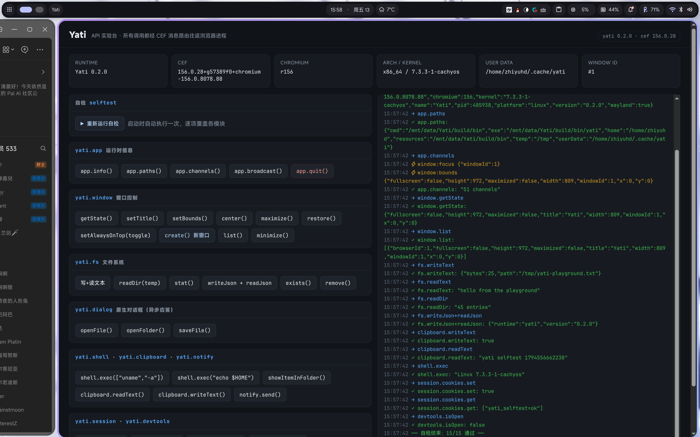
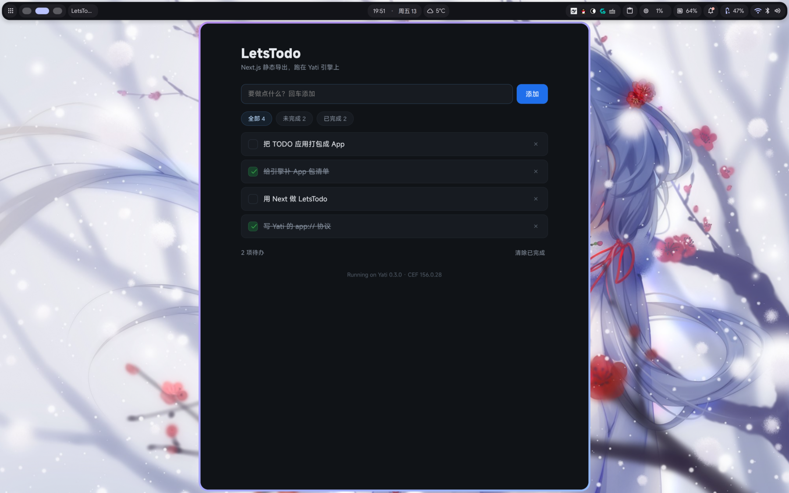

<div align="center">


<h3>用 HTML / CSS / JS 写桌面应用，内核是真 Chromium</h3>

<p>
  
  
  
</p>

</div>

---

## 这是什么

Yati 是一个桌面应用运行时。你写一个普通网页，Yati 给它在桌面上开一个原生窗口；网页里的 JS 通过
`yati.*` 直接操作窗口、文件、原生对话框、剪贴板、通知、Cookie 和 DevTools。

定位和 Electron 一样——**Web 当界面层，C++ 当能力层**。区别是内核用 CEF（Chromium Embedded
Framework），而且能力层就是这套仓库里的 C++ 代码，想加什么能力自己写一个通道就行。

CEF 运行时（约 1.5 GB）不随仓库分发，`scripts/fetch-deps.sh` 会一次性拉取并校验 SHA1；之后 `./build.sh` 就能跑。

## 能用来做什么

- 内部工具、运维面板、桌面小工具：直接复用现成网页，不用学新的 UI 框架
- 需要真正访问本地文件、跑命令、系统集成的 Web 前端
- 想在 C++ 侧做重活（编解码、硬件、系统调用），把界面完全留给 Web
- 想自己掌控 Chromium 版本：渲染行为跟着你打包的版本走，不受用户系统影响

**不适合**：对安装包体积敏感（CEF 运行时约 1.5 GB）、今天就要 Windows / macOS（目前只跑 Linux）。

## 和其他方案的区别

| | 界面层 | 能力层 | 体积 | 平台 |
| --- | --- | --- | --- | --- |
| **Yati** | 任意网页 | **C++**（内置 9 组 API，可扩展） | ~1.5 GB | Linux |
| Electron | 任意网页 | Node.js | ~150 MB | 全平台 |
| Tauri | 任意网页 | Rust | ~10 MB（用系统 WebView） | 全平台 |

取舍很直白：Yati 用体积换**渲染一致性**和**C++ 侧的可控性**。

## 长什么样



内置的 API 实验台：左边点按钮调各种能力，右边实时看请求/响应和窗口事件，右下角是启动时自动跑的自检。

## 能做什么

|  | 能力 | 你可以 |
| --- | --- | --- |
|  | **窗口** | 开多个窗口、改尺寸标题、全屏置顶、监听尺寸与焦点变化 |
|  | **文件系统** | 读写文本 / 二进制 / JSON、遍历目录、stat、复制移动删除 |
|  | **原生对话框** | 调系统文件选择器、目录选择器、保存框 |
|  | **子进程** | 跑命令并拿回 stdout / stderr / 退出码，自带超时保护 |
|  | **剪贴板** | 读写系统剪贴板（Wayland / X11 都支持） |
|  | **通知** | 发系统通知，可设紧急度与时长 |
|  | **会话** | 读写、删除、清空 Cookie |
|  | **调试** | 一键开 DevTools，或 `--inspect` 接 CDP 工具 |
|  | **双向事件** | C++ 主动推事件给页面，页面订阅、广播 |

## 安装

Arch Linux 用户直接从 AUR 装：

```bash
yay -S yati        # 或 paru -S yati
yati               # 默认以沙箱模式启动
```

其他发行版走下面的源码构建。

## 跑起来

```bash
./scripts/fetch-deps.sh   # 首次：拉 CEF 构建包与 cmake/ninja（约 400 MB）
./build.sh                # 约 2 分钟（含 CEF 包装层）
build/bin/yati            # 打开内置实验台
```

你的应用就是一个网页。把 `webui/index.html` 换成自己的，Dialog 一行就能用上原生能力：

```html
<script src="preload.js"></script>
<script>
  const { version } = await yati.app.info();
  await yati.fs.writeText('~/hello.txt', 'hi from Yati');
  await yati.notify.send('Yati', `运行在 CEF ${version}`);
</script>
```

用 TypeScript 的话，把 `types/yati.d.ts` 加进 `include`，`yati.*` 就有完整补全，不需要打包器或 import。

## 把 Yati 当引擎用

Yati 本身就是一个引擎。写一个基于 Yati 的 App，不需要碰 C++，只要一个目录：

```
my-app/
├── yati.json      # 清单
└── index.html     # 你的网页
```

```json
{
  "id": "com.example.myapp",
  "name": "My App",
  "version": "1.0.0",
  "main": "index.html",
  "window": { "title": "My App", "width": 900, "height": 600 }
}
```

```bash
yati ./my-app          # 或 yati --app=./my-app
```

- `window.yati` 由**引擎注入**，App 的 HTML 里不用引 `preload.js`，而且在页面脚本执行前就可用
- `id` 决定缓存隔离：数据落在 `~/.cache/com.example.myapp`，多个 App 互不影响
- `main` 是入口页，可以换成 `app.html`、`dist/index.html`
- App 通过 `yati.app.info()` 区分「App 版本」与「引擎版本」
- 用 Next.js / Vite 也行：静态导出里的绝对路径 `/_next/...` 由引擎的 `app://` 协议在 App
  自己的源里解析；`main` 指向子目录（如 `out/index.html`）时，站点根自动取该目录

只给网页、把引擎当依赖的发行方式：App 包只装自己的静态文件 + 一行启动器，CEF 与引擎由
`yati` 包提供，不用每个 App 塞 1.5 GB 的 Chromium。

两个跑得起来的示例：

- [`examples/hello`](examples/hello)：纯 HTML，最少依赖，覆盖注入、文件、通知、窗口标题
- [`examples/letsTodo`](examples/letsTodo)：Next.js 16 静态导出 + React 19 的 TODO 应用



## API 一眼看完

| 模块 | 常用调用 |
| --- | --- |
| `yati.app` | `info()` `paths()` `quit()` `broadcast()` |
| `yati.window` | `getState()` `setBounds()` `setTitle()` `maximize()` `create()` `list()` |
| `yati.fs` | `readText()` `writeText()` `readJson()` `readDir()` `stat()` `remove()` |
| `yati.dialog` | `openFile()` `openFolder()` `saveFile()` |
| `yati.shell` | `exec()` `openExternal()` `showItemInFolder()` |
| `yati.clipboard` | `readText()` `writeText()` |
| `yati.notify` | `send()` |
| `yati.session` | `cookies.get()` `cookies.set()` `cookies.clear()` |
| `yati.devtools` | `open()` `close()` `isOpen()` |

全部 51 个通道、错误码与事件表见[技术笔记](docs/technical-notes.md)。

## 现状

- 版本 **0.2.0**，Linux x86_64，CEF 156 / Chromium 156
- 启动自检 **15/15**，单元测试 **9/9**
- 两套构建都可用：CMake（`./build.sh`）与自己造的 Yubild（`yubild build --release`）

## 想深挖

- [技术笔记](docs/technical-notes.md)：CEF 二进制与校验、构建、架构、通道清单、打包与排查
- [Yubild 迁移记录](docs/yubild-gaps.md)：用自己的构建系统跑通这套工程的两轮实测与改进点
- [types/yati.d.ts](types/yati.d.ts)：完整类型定义

## 许可证

本项目以 [MIT 许可证](LICENSE) 发布。内核 CEF / Chromium 遵循 BSD 许可（见所下载分发包内的 `LICENSE.txt`）。

## 致谢

内核是 [CEF](https://github.com/chromiumembedded/cef) / Chromium，遵循 BSD 许可（见 `vendor/cef/` 内的
`LICENSE.txt`）。README 图标由 [icons.zhiyuhub.top](https://icons.zhiyuhub.top/) 生成。
